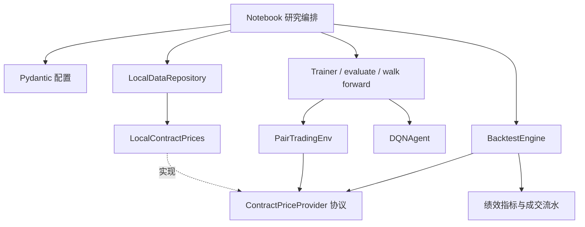

# 架构与扩展

## 设计原则

采用 `src` 布局，可通过标准构建工具安装。[notebook/RPTv9.ipynb](../notebook/RPTv9.ipynb) 是研究入口，不再定义交易账户、神经网络或训练器。配置、领域概念、基础设施和应用流程各有明确职责，类似 Java 项目中 DTO、枚举、Repository 和 Service 的分层，但不引入没有实际用途的抽象工厂或依赖注入容器。



## 模块合同

| 模块 | 职责 | 不承担的职责 |
|---|---|---|
| `config.py` | 配置类型、约束、路径解析、独立凭据 | 创建目录、联网或训练 |
| `domain.py` | 动作、仓位、设备、激活函数、交易所枚举 | 以字符串散落表达交易行为 |
| `data/` | 输入校验、共同交易日对齐、合约行情、协整统计 | 原地修改数据、自动补价格 |
| `environment/` | 生成时点一致的状态与奖励 | 操作资金账户、读取全局 DataFrame |
| `agents/` | 网络、动作策略、回放、梯度更新 | 决定训练和测试日期 |
| `training/` | 训练、验证选模、评估、窗口迭代 | 用测试集参与选模 |
| `backtesting/` | 目标仓位、资金与保证金、逐日结算、成交记录 | 调参或调用在线行情 |
| `artifacts.py` | 显式创建运行目录，写配置与运行环境快照 | 导入时产生文件 |

Pydantic 用于跨模块输入（配置和信号）；NumPy / Pandas 用于计算；小型 `dataclass` 用于内部持仓和结果对象；PyTorch 模型保持原生 `nn.Module`。不把每一个 Tensor 或 DataFrame 包成 Pydantic 模型，避免训练循环中的重复校验开销。

## 调用示例

```python
from pathlib import Path
from rl_pairtrading.config import load_config
from rl_pairtrading.data.repository import LocalDataRepository, align_pair
from rl_pairtrading.environment.pair_trading import PairTradingEnv
from rl_pairtrading.agents.dqn import DQNAgent
from rl_pairtrading.training.windows import walk_forward_windows
from rl_pairtrading.training.trainer import Trainer, evaluate

config = load_config(Path("configs/smoke.toml"))
repository = LocalDataRepository(config)
first, second = align_pair(*(repository.load(s) for s in config.research.primary_pair))
prices = repository.contract_prices()
window = next(walk_forward_windows(len(first), config.environment.lookback, config.walk_forward))


def make_env(part):
    return PairTradingEnv(first.iloc[part], second.iloc[part], config.environment, prices)


agent = DQNAgent(config.environment.state_size, config.agent, config.network, config.training.seed)
training = Trainer(config.training).fit(agent, make_env(window.train), make_env(window.validation))
test = evaluate(make_env(window.test), agent)
```

## 扩展路径

### 新品种

在 TOML 增加一个 `[[instruments]]`，提供代码、文件名、合约乘数、保证金率。品种代码使用受格式校验的字符串，不使用封闭枚举：新增品种不需要修改核心源码。交易所、动作等有限集合使用枚举。

### 新数据源

主连数据返回满足 `validate_market_data()` 约束的 DataFrame。换月报价源实现 `ContractPriceProvider.open_price(contract, date)`，注入环境和回测器即可。导入包不建立网络连接；当前交付的实现只有本地行情提供器。可选 Tushare 依赖为后续在线适配预留。

### 新策略或算法

用于评估的策略只需实现 `Policy.predict_action(state)`。如增加 PPO / SAC，应编写各自训练器和轨迹管理，不强行塞进 DQN 的回放接口。动作仍返回 `Action`，以复用评估和信号格式。

### 新特征

修改 `PairTradingEnv._state()` 和 `EnvironmentConfig.state_size`，补维度与因果性测试。特征顺序属于模型接口，改变顺序、维度或缩放后需要重新训练。将新增可调窗口放入配置类和 TOML，不在特征实现中埋入实验参数。

### 新账户规则

当前 `BacktestEngine` 负责透明的研究账户，开仓资金检查以整个配对为单位，结算现金检查在所有腿结算完毕后进行。要支持整手取整、不同费率、风险预算等，可拆出独立的仓位分配器或费率策略，再通过显式构造参数注入。先根据真实需求提取接口，不预先堆叠继承结构。

## 错误处理与并发

缺数据、缺换月报价、无效配置和资金不足都会明确报错；不使用裸 `except` 把失败伪装成正常结束。每个环境、智能体、账户和运行目录都有独立状态。`seed_everything()` 会设置进程级随机数，当前不保证同一进程内多线程训练互不干扰；并行研究应使用独立进程和独立输出目录。
